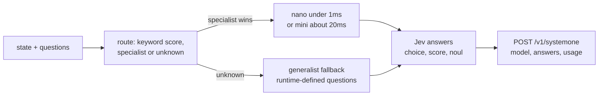

# sabaki-js

**Typed decisions on CPU, in milliseconds - Jev-compatible, plugin-routed, open.**

Sabaki routes an unstructured state to the right tiny classifier and returns a **typed answer** (`choice` / `score` / `noul`) with calibrated confidence - over an HTTP API that speaks the [System One](https://docs.typesafe.ai/concepts/system-one) contract. No GPU, no API key, no per-call cost.

```ts
import { Sabaki } from "sabaki";
import mail from "@sabaki-js/mail";

const sabaki = new Sabaki().register(mail).setFallback(generalist);
await sabaki.decideAsync({ state: "Invoice charged twice, need a refund", question: "bucket" });
// { decision: "billing", confidence: 0.89, domain: "mail", plugin: "@sabaki-js/mail" }
```

Live: `https://sabaki.fox3000foxy.com/v1/systemone` - or self-host in one line: `await sabaki.serve({ port: 8000 })`. See the [GUIDE](https://github.com/sabaki-js/sabaki/blob/main/GUIDE.md).

## Packages

| package | what |
|---|---|
| [sabaki](https://github.com/sabaki-js/sabaki) | router core + generalist fallback + Jev shapes |
| [@sabaki-js/customer-service](https://github.com/sabaki-js/plugin-customer-service) | tickets (category 0.900 nano) |
| [@sabaki-js/invoice-processing](https://github.com/sabaki-js/plugin-invoice-processing) | invoices (duplicate 0.89) |
| [@sabaki-js/security-incidents](https://github.com/sabaki-js/plugin-security-incidents) | triage (disposition 0.73) |
| [@sabaki-js/agent-trace-observability](https://github.com/sabaki-js/plugin-agent-trace-observability) | agent traces |
| [@sabaki-js/mail](https://github.com/sabaki-js/plugin-mail) | email triage (8 buckets, 0.889) |
| [@sabaki-js/doom](https://github.com/sabaki-js/plugin-doom) | Doom decisions (MAP01 exits on video) |
| [@sabaki-js/generalist](https://github.com/sabaki-js/workspace) | open questions (cross-encoder, in core) |
| [@sabaki-js/plugin-template](https://github.com/sabaki-js/plugin-template) | starter template |

## How it decides



Specialists answer their trained questions; the generalist answers **anything** (`instructions` + `criteria`, truly read by the model). The `model` field always names the actual responder.

## Benchmarks (typed-decisions, test splits)

| system | score | params | CPU | note |
|---|---|---|---|---|
| OpenDecider-nano | 0.796 | 400M | GPU (offline OK) | fine-tuned, published |
| Laya typed-decisions | 0.766 | 421M | GPU (25 s/state on CPU) | fine-tuned, published |
| TypeSafe Jev | 0.754 | API | API only | zero-shot, published |
| **sabaki mini** | **0.69** | 22M int8 | **~20 ms** | ECE < 0.14, healthy OOD doubt |
| **sabaki nano** | **0.61** | ~0 | **<1 ms** | zero deps, ~18k req/s |
| **sabaki generalist (mini)** | 0.756 | 22M | ~20-36 ms | served; phishing R=0.616, td 0.536 |
| Laya base | 0.362 | 421M | GPU | zero-shot, published |

\* the served generalist (**mini**, 22.7M) scores **0.536** on the typed-decisions **test split** (vs 0.29 for v4) plus phishing recall 0.616 on 2,000 held-out emails — measured, preliminary, improving.

### Generalist generations (preliminary)

| generation | mix val* | PhishNChips recall | typed-decisions test |
|---|---|---|---|
| v4 | 0.848 | R=0.026 | 0.29 |
| v5 | 0.838 | R=0.066 | — |
| A (22M, 80k) | 0.898 | R=0.406 | 0.546 |
| **mini (served)** | 0.756 | R=0.616 | 0.536 |
| B (144M, 80k, scratch) | 0.692 | R=0.062 | 0.568 |

\* own split per run (not comparable across rows). PhishNChips (2,000 held-out emails) and the typed-decisions test split are identical for every row. †n=200 subset.

### Sabaki is the smallest here: larger open decision models (144–151M, CPU), for reference

sabaki generalist is **22.7M** — about **6.5× smaller** than the smallest model below, and the smallest *general-purpose* decision model in this list (Cua-S1's 706K scorer is smaller but form-specific). Figures below are **self-reported** by their authors unless noted; protocols and splits differ.

| model | params | languages | notes | source |
|---|---|---|---|---|
| openJev-verdict-2.0 | 151M (ModernBERT) | en | claims the top spot over Jev and Laya on the LocalLLaMA typed-decisions benchmark (self-reported) | [GitHub](https://github.com/Heman10x-NGU/openJev-verdict-2.0) |
| julia-1 | 144M (mmBERT-small) | **multilingual** | CPU, `choice`/`score`/`noul` with probabilities | [HF](https://huggingface.co/SupersonicLabs/Julia-1) |
| Open Jev | 150M (ModernBERT) | en | per-request decisions in one pass; trains on a Colab T4 in ~30 min | [GitHub](https://github.com/intikhab49/open-jev-typed-decision-engine) |
| Phocinae / Largha-150M | 144M (mmBERT-small) | en + zh | calibrated, robust to option reordering | [GitHub](https://github.com/Phocinae/Phocinae-Largha-150M-v1) |
| WaterSheep | ModernBERT-base | en | reports 61.2% accuracy, 0.043 ECE on unseen data (self) | [GitHub](https://github.com/SamratDuttaOfficial/WaterSheep) |
| Vela | 0.3B–9B | 17 languages | ONNX + Core ML, router-oriented | [HF](https://huggingface.co/vllm-sr/Vela-2.0-0.3B) |

A few points less for **1000× lower latency**: nano ~18 000 req/s, mini ~71 req/s (1 thread) - a 35 Hz game tick fits on any CPU. See [@sabaki-js/doom](https://github.com/sabaki-js/plugin-doom): the same stack exits MAP01 end-to-end (video in repo).

Mail bucket8: nano **0.865** anonymized (0 PII). All packages via npm trusted publishing (provenance). MIT.
